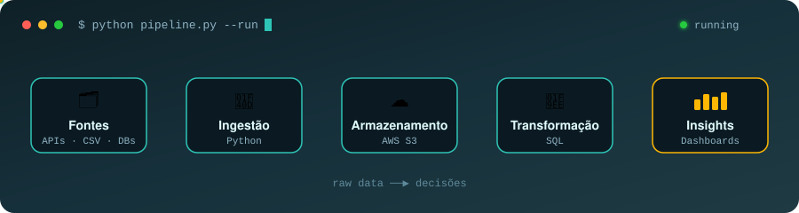

<!-- Banner -->

  

  

## 👋 Sobre mim

- 💻 Desenvolvedor com experiência em **desenvolvimento web** (JavaScript, TypeScript, HTML/CSS), migrando para **Análise e Engenharia de Dados**
- 🐍 Foco atual: **Python, SQL e AWS** para construir pipelines e transformar dados em decisões
- 🎯 Interesse em modelagem de dados, ETL/ELT e arquitetura de dados na nuvem
- 📈 Gosto de transformar dados brutos em informação útil para o negócio

  

## 🛠️ Stack

<table>
  <tr>
    <td align="center" width="33%"><b>Linguagens</b></td>
    <td align="center" width="33%"><b>Dados &amp; Cloud</b></td>
    <td align="center" width="33%"><b>Ferramentas</b></td>
  </tr>
  <tr>
    <td align="center"></td>
    <td align="center"></td>
    <td align="center"></td>
  </tr>
  <tr>
    <td align="center">Python · JavaScript · C</td>
    <td align="center"><b>AWS</b> · SQL</td>
    <td align="center">Git · VS Code</td>
  </tr>
</table>

## 📚 Estudando agora

  
  
  
  
  

## 📊 Projetos de dados

> 🚧 **Em construção.** Os primeiros projetos de análise e engenharia de dados estão sendo preparados e vão aparecer aqui em breve.

<!--
Modelo para quando publicar um projeto (copie uma linha por projeto):

| Projeto | Descrição | Stack |
|---|---|---|
| [nome-do-repo](https://github.com/marceuschmidt/nome-do-repo) | O que o projeto faz em uma frase | Python · SQL · AWS |
-->

## 🧩 Outros projetos

| Projeto | Descrição | Stack |
|---|---|---|
| [FichaAuto](https://github.com/marceuschmidt/fichaauto) | Site de apresentação de um sistema para oficinas mecânicas | HTML · CSS · JS |
| [ms_financas](https://github.com/marceuschmidt/ms_financas) | Web app mobile de finanças pessoais | TypeScript |

<!--
## 📫 Contato

  
  

-->

<!-- Rodapé -->

  

